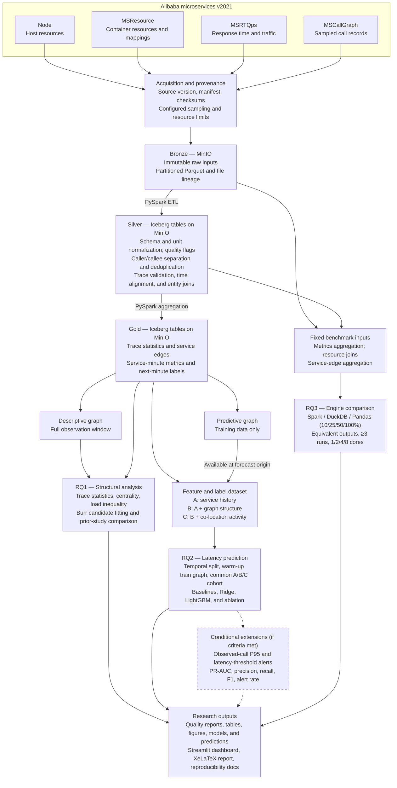

# Microservice Dependency Analysis and Latency Prediction with a Data Lakehouse

**IE212 — Big Data Technologies**

**Authors:**
- Nguyen Thuy Vy - 24522071
- Tran Ngoc Gia Huy - 24520703

**Final presentation:** 17 December 2026

## Overview

This project investigates microservice dependencies, structural service importance, and short-horizon latency prediction using the Alibaba `cluster-trace-microservices-v2021` dataset. A batch-oriented data lakehouse is proposed to integrate call records, service metrics, container resources, and host measurements into reproducible analytical datasets.

The study combines descriptive graph analysis, next-minute mean RPC response-time prediction, and comparative processing benchmarks. Structural centrality is interpreted as an indicator of architectural importance; associations with resource utilization or latency do not establish causal bottlenecks.

## Implementation Status

As of **25 November 2026**, the repository contains the validated directory scaffold, `pyproject.toml`, environment templates, and pre-implementation decision logs. Live CSV headers and sampling cadences for all four Alibaba v2021 tables have been verified against Alibaba OSS, and pre-implementation technical choices have been locked in [`docs/decisions.md`](docs/decisions.md). Full data acquisition, executable ETL pipelines, infrastructure deployment, model training, and empirical evaluation have not yet been completed. Docker Compose, the dependency list, and YAML files remain scaffolding until P0/P1 verification (`T05`, `T08`).

The following diagram presents the **proposed architecture**. Execution commands and pinned dependency versions will be documented after the corresponding stages have been implemented and tested.

## Research Questions

| Question | Objective | Planned evidence |
| --- | --- | --- |
| **RQ1 — Dependency structure and service importance** | Characterize trace-level call graphs and service dependency networks; examine relationships between structural importance, load, resources, and latency. | Trace size and depth; communication types by depth; degree distributions; load concentration and load inequality; centrality rankings (`Degree`, `PageRank`, `Approximate Betweenness`, `K-core`); candidate **Burr** distribution fitting (accounting for discreteness and Luo et al.'s 99th-percentile tail truncation) and qualitative comparison with prior studies. |
| **RQ2 — Predictive value of graph and co-location features** | Determine whether graph structure and co-located resource activity improve next-minute mean RPC latency prediction beyond service history. | Persistence and Moving Average baselines; Ridge Regression and Global LightGBM; A/B/C ablation on a common cohort with effect size and paired Wilcoxon signed-rank + Holm correction where applicable; pooled and per-service MAE and RMSE. Conditional extensions: P95 from individual observed calls and threshold/hypothetical SLO alerts (`PR-AUC`, precision, recall, F1, alert rate). |
| **RQ3 — Data processing performance** | Compare Spark, DuckDB, and Pandas on equivalent workloads as input size increases under controlled resource limits. | Runtime, peak memory, measurable spill (or `NA`), result-equivalence checks, repeated measurements (≥3 runs), 1/2/4/8-core scaling on a representative parallelizable workload, and explicit OOM/timeout/unsupported records. |

## Proposed Pipeline



MinIO provides object storage (`9000`/`9001`), Parquet provides the columnar file representation, and Apache Iceberg manages Silver and Gold tables through an **Iceberg REST Catalog** (`8181`) deployed on Docker Linux on the primary execution host. PySpark (pinned to `4.1.*` or `3.5.*` to match Maven `iceberg-spark-runtime`) is the primary ETL engine. After PySpark aggregates `service_edges`, **NetworKit** computes all four centrality measures (`Degree`, `PageRank`, `EstimateBetweenness`, `CoreDecomposition`) on Python 3.11/3.12. An initial Spark deployment operates locally; distributed multi-node scalability claims require separate empirical evidence.

RQ3 evaluates transformations on fixed, documented inputs. DuckDB prioritizes direct `iceberg_scan('s3://...')` (with an explicit Parquet-export fallback whose export cost is recorded separately if catalog compatibility limits are encountered in P1). Any conversion required for engine interoperability will be documented, together with whether its cost is included in the measured workload.

## Data and Experimental Methodology

### Data preparation

The four input groups differ in entity coverage and measurement characteristics. Acquisition will record source versions, file sizes, checksums, row counts, and observation intervals. Validation will address missing and sentinel values, duplicates, conflicting keys, measurement units, and sampling intervals.

When sampling `MSCallGraph`, the project uses the trace-partitioned **CASPER Shuffled v2021** release (`doi:10.7910/DVN/RXIC9Z`, Huye et al., ACM/SPEC ICPE 2024) so sampled hash partitions preserve complete `traceid` records without cross-file fragmentation, while streaming the full 12-hour `Node`, `MSResource`, and `MSRTQps` archives from Alibaba OSS directly into Bronze Parquet with checksum manifests. Live inspection verified 30-second cadences for **both** `Node` and `MSResource` (requiring 30s→60s alignment before joining 60-second `MSRTQps`), six `rpctype` values (`rpc`, `mc`, `http`, `userDefined`, `db`, `mq`), negative `mq` latencies, and non-comparable `Node` vs. container utilization denominators. Call processing distinguishes caller-side and callee-side observations before deduplication or response-time normalization. Quality reports disclose exclusions, incomplete traces, join coverage, and unexpected row multiplication.

### Latency prediction

A prediction sample represents a service at forecast-origin minute `t`; its target is mean incoming RPC response time in minute `t + 1`. Container-level `providerRPC_RT` values will be aggregated using `providerRPC_MCR` weights only after measurement-window compatibility has been verified. Missing targets and zero-traffic denominators will remain explicitly unavailable.

| Configuration | Information available at the forecast origin |
| --- | --- |
| **A — Service history** | Historical latency, traffic, service resources, lagged values, and rolling statistics. |
| **B — Graph structure** | All features in A, supplemented by structural descriptors from a graph constructed exclusively from training data. |
| **C — Co-location activity** | All features in B, supplemented by host load and observed activity of other containers sharing the host. |

Train, Validation, and Test will be separated chronologically by target timestamp, with an initial proposed ratio of **70/15/15**. Preprocessing will be fitted on Train, model selection will use Validation, and Test will be reserved for final evaluation. A/B/C comparisons will use the same services and timestamps. To prevent intra-train leakage, the training-only graph snapshot uses a dedicated **warm-up window** at the start of Train so graph descriptors are strictly available at every forecast origin. Paired Wilcoxon signed-rank tests with Holm correction and effect sizes serve as supplementary analysis when statistical assumptions hold.

The full-window graph used for descriptive RQ1 analysis will be maintained separately from the training-only graph used for RQ2. Persistence and Moving Average will provide reference forecasts before Ridge Regression and Global LightGBM are evaluated. RQ1 centrality measures comprise Degree, PageRank, Approximate Betweenness, and K-core, with algorithm settings and graph conventions documented.

### Processing benchmarks

The workloads comprise service-minute metric aggregation, joins between metrics and container/host resources, and service-edge aggregation. Each engine will process **10%, 25%, 50%, and 100% of the declared benchmark input**, subject to feasible resource limits. These percentages do not imply coverage of the entire Alibaba dataset.

Output equivalence will be checked before performance comparisons. Each configuration will be executed at least three times, with resource limits, cache policy, materialization, and measurement boundaries documented. Runtime, peak memory, and measurable spill will be retained alongside out-of-memory, timeout, and unsupported-operation outcomes. A separate experiment will consider 1/2/4/8 cores where hardware and engine capabilities permit meaningful parallel execution.

### Scope and limitations

The study concerns retrospective batch analysis within the observed dataset. Streaming systems, deployment optimization, intervention-based causal analysis, and deep learning models are outside the current scope. Generalization beyond the observed period or system requires additional evidence.

P95 prediction and latency-threshold alerts are conditional extensions. P95 would be derived from individual observed calls, subject to sample-count, coverage, and stability criteria; it will not be inferred from container-level mean response times. Alert thresholds will be described as experimental thresholds or hypothetical SLOs.

## Repository Structure

```text
ie212-microservices/
├── README.md
├── pyproject.toml
├── .gitignore
├── .env.example
├── docker-compose.yml
├── requirements.txt
├── configs/
│   ├── data.yaml
│   ├── lakehouse.yaml
│   ├── features.yaml
│   ├── experiments.yaml
│   └── benchmarks.yaml
├── src/ie212/
│   ├── ingestion/
│   ├── quality/
│   ├── silver/
│   ├── gold/
│   ├── graphs/
│   ├── features/
│   ├── models/
│   ├── evaluation/
│   └── benchmarks/
├── scripts/
├── tests/
├── notebooks/
├── dashboard/
├── artifacts/
│   ├── manifest/
│   ├── models/
│   ├── predictions/
│   └── benchmarks/
├── reports/
│   ├── data_quality/
│   ├── figures/
│   └── tables/
├── docs/
│   ├── data_dictionary.md
│   ├── decisions.md
│   ├── resources.md
│   ├── sampling_plan.md
│   ├── split_cohort.md
│   └── benchmark_design.md
└── data/
    ├── README.md
    ├── raw/
    └── sample/
```

Reusable implementation belongs in `src/ie212/`, stage entrypoints in `scripts/`, and exploratory work in `notebooks/`. Configuration files define paths, sampling, resource limits, feature definitions, and experimental parameters. Generated artifacts will be associated with run identifiers. Empty directories are retained with `.gitkeep` files, and Python packages contain `__init__.py` files.

## Documentation and Reproducibility

The authoritative project specification (`metadata.txt`), implementation guide (`agents_ie212.md`), and planning/structure workbooks (`IE212_ke_hoach.xlsx`, `IE212_cau_truc_thu_muc_cap_nhat.xlsx`) are maintained **outside the repository** in each contributor's local workspace context directory (excluded via `.gitignore`). Contributors must consult these documents before implementation; no machine-specific absolute paths or copies of those workbooks should be committed to Git.

Technical documentation is maintained in a flat `docs/` directory. The team will supply its existing LaTeX report as `docs/main.tex` (compiled with **XeLaTeX** for Vietnamese Unicode support); this file is not yet present. Analytical figures and tables belong in `reports/figures/` and `reports/tables/`, referenced through `../reports/figures/` and `../reports/tables/`. The interactive dashboard will be implemented in `dashboard/` using **Streamlit**.

Reproducibility records will include data manifests, seeds, sampling scope, environment versions, resource budgets, split boundaries, model parameters, graph snapshots, and benchmark conditions. Results will be reported as measured, including cases where additional features do not improve prediction or a single-machine engine outperforms Spark.

## References

1. Luo et al. (ACM SoCC 2021), *Characterizing Microservice Dependency and Performance: Alibaba Trace Analysis*, DOI: `10.1145/3472883.3487003`.
2. Winchester, Parisis, Xu & Berthouze (2025), *Complexity at Scale: A Quantitative Analysis of an Alibaba Microservice Deployment*, `arXiv:2504.13141` (Alibaba v2022 qualitative comparison).
3. Bakhtin, Esposito, Lenarduzzi & Taibi (ICSA 2025), *Network Centrality as a New Perspective on Microservice Architecture*, `arXiv:2501.13520`.
4. Huye, Liu & Sambasivan (ACM/SPEC ICPE 2024), *Systemizing and Mitigating Topological Inconsistencies in Alibaba's Microservice Call-Graph Datasets (Casper)*, DOI: `10.1145/3629526.3645043` (Shuffled v2021 dataset: `doi:10.7910/DVN/RXIC9Z`).

## Collaboration

Development takes place in a shared repository using `feature/<task>` branches. Each change is submitted through a pull request and reviewed by the other team member before merging. Raw data, credentials, and large generated artifacts must remain outside version control. Weekly planning and repository-structure workbooks are maintained in the external workspace context directory.
